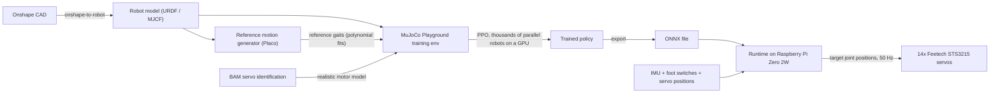
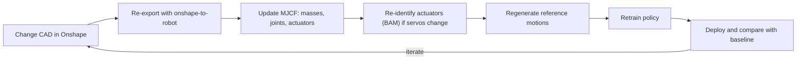
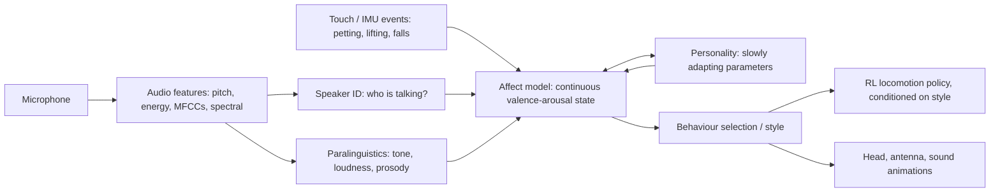

**Goal:** build the Open Duck Mini v2, understand how it is trained, get it walking, then redesign it into your own version.

  
> [!NOTE]
> The roadmap runs on two tracks at the same time: 
> The **Build track** is printing parts and buying components. 
> The **Learning track** is the theory and software. 

---
## 0. The big picture: how the duck learns to walk

Nobody writes the walking motion by hand. A **neural network policy** learns it by trial and error in a **physics simulator** (millions of falls, sped up). The trained network is then copied onto the real robot.

  

  

**One control step on the real robot (about 50 times per second):**

1. **Observe:** read the IMU (body orientation and angular velocity), joint positions and velocities, foot contacts, the joystick command and the previous action.

2. **Think:** feed these numbers into the neural network (the policy).

3. **Act:** the network outputs **target joint angles**. Each servo's built-in PD controller then moves toward its target.

  

**Training** means finding network weights that score well on a **reward**: follow the commanded velocity, look like the reference gait, don't fall, don't shake, use little energy. Each phase below explains one piece of this diagram.

  

### The Open Duck repositories

  

| Repo | What it does | Phase |

|---|---|---|

| [Open_Duck_Mini](https://github.com/apirrone/Open_Duck_Mini) (`v2` branch) | Parts list, CAD links, assembly guide | 1, 2 |

| [Open_Duck_reference_motion_generator](https://github.com/apirrone/Open_Duck_reference_motion_generator) | Generates walking gaits that the policy learns to imitate | 7 |

| [Open_Duck_Playground](https://github.com/apirrone/Open_Duck_Playground) | RL training environments (MuJoCo Playground / JAX) | 7 |

| [Open_Duck_Mini_Runtime](https://github.com/apirrone/Open_Duck_Mini_Runtime) (`v2` branch) | Code that runs on the robot | 1, 8 |

| [Open_Duck_Mini_Viewer](https://github.com/mertcookimg/Open_Duck_Mini_Viewer) | 3D viewer in the browser | any |

  

---

  

## Self-assessment: where are your gaps?

  

Tick what you can already do comfortably. **Anything unticked is where to focus.**

  

| Area | Can you… | Phase |

|---|---|---|

| Linux / tooling | Use the terminal, SSH into a Pi, use git branches, set up Python environments (`uv` / venv) | 0 |

| Python numerics | Write vectorised NumPy code, plot with matplotlib | 0 |

| Linear algebra | Multiply matrices, explain what a rotation matrix is, explain eigenvalues roughly | 2 |

| 3D rotations | Convert between Euler angles, rotation matrices and **quaternions**; explain gimbal lock | 2 |

| Kinematics | Compute forward kinematics of a 2–3 joint leg; explain what inverse kinematics is | 2 |

| Dynamics / control | Tune a PID/PD loop; explain stiffness vs. damping; read a Bode plot (nice-to-have) | 3 |

| Probability | Explain expectation, variance and Gaussian distributions; sample from a distribution | 5 |

| ML basics | Train a small neural network in PyTorch or JAX; explain gradient descent and overfitting | 5 |

| Reinforcement learning | Define an MDP, policy, value function, reward, return | 5 |

| Embedded comms | Debug UART / I2C; read a datasheet register map | 1 |

  

---

  

## Phase 0: Tooling foundations (about 1 week, skip whatever you know)

  

**Why:** every repo uses Linux, git, Python and `uv`. Training uses **JAX** on an NVIDIA GPU.

  

**Learn:**

- Linux shell, SSH, `tmux` (for training runs that keep going after you disconnect).

- Git: clone, branches, forks (you'll fork the repos for your own version).

- Python environments with [`uv`](https://docs.astral.sh/uv/) (used by the Open Duck repos).

- NumPy, then **JAX basics**: `jit`, `vmap`, `grad`. See the [JAX tutorial](https://docs.jax.dev/en/latest/tutorials.html).

  

**Compute check:**

- Training needs an **NVIDIA GPU with CUDA**. Your laptop (Intel Iris Xe) can **run the simulator, view policies and do the Phase 4–5 exercises on CPU**, but not train the duck in a reasonable time.

- **Options while you don't have a lab GPU:**

  

| Option | Cost | Notes |

|---|---|---|

| **University / lab HPC cluster** | Free | Ask your professor or IT. Many universities have GPU nodes (usually managed with a job scheduler called SLURM). Best long-term option. |

| **Google Colab** | Free tier (T4 GPU, time-limited); Pro ≈ US\$10/month | Easiest start. MuJoCo Playground provides Colab notebooks. Sessions disconnect, so save checkpoints to Google Drive. |

| **Kaggle Notebooks** | Free (about 30 GPU-hours/week) | Similar to Colab, with more predictable quotas. |

| **Rented cloud GPUs** (RunPod, Lambda, Vast.ai) | About US\$0.3–1.5/hour for an RTX 4090 / A10 / L4 | A full Linux machine with a GPU, reached over SSH. Best for real training runs. Always **shut it down** when you're done. |

| **Big clouds** (GCP / AWS / Azure) | Pay-as-you-go; free credits for students and research | More setup. Check for student or academic research credits. |

  

- How cloud training works: rent a Linux machine with a GPU, SSH into it, clone your repo, run training inside `tmux`, then download the checkpoint / ONNX file to your laptop to view in MuJoCo.

  

**✅ Done when:** you can clone a repo, create its environment with `uv`, and run a JAX script on the GPU (`jax.devices()` shows `cuda`).

  

---

  

## Phase 1: Robot hardware and electronics (Build track, 3–6 weeks, runs in parallel)

  

You already have most of the background here. The focus is on the **parts specific to this robot**.

  

**Main components** (verify everything against the `v2` parts list):

- **14× Feetech STS3215 serial bus servos:** 5 per leg (hip yaw / roll / pitch, knee, ankle) and 4 in the neck/head.

- **Raspberry Pi Zero 2W** (the computer), plus a **Waveshare bus servo driver board** (USB/UART to the servo TTL half-duplex bus).

- **BNO055 IMU** on I2C, and **foot contact switches** on GPIO.

- **2S Li-ion pack + BMS**, with a step-down regulator for the Pi. Servos run directly from battery voltage.

- Expression add-ons: antenna servos, eye LEDs, speaker (I2S amplifier).

  

**Concepts to really understand:**

1. **How a smart servo works.** The STS3215 is **not** a torque motor. It runs its own internal **position PD loop**, so the policy sends *target positions*. Learn the register map: ID, baud rate, P/D gains, torque limit, position offset. Read the Feetech / Waveshare STS3215 docs.

2. **Half-duplex serial bus.** Many servos share one wire, each with its own ID. Bus speed and read latency limit the control rate.

3. **Servo IDs and zero offsets.** Configure each servo **before** assembly, using the runtime repo's setup script. A wrong zero means the real robot's joint angles won't match the simulator.

4. **IMU orientation.** Know which way the BNO055 is mounted and what reference frame it reports in. The policy depends on it.

5. **Power.** Peak current when 14 servos stall at once, voltage sag, brown-outs resetting the Pi.

  

**Resources:** the v2 assembly guide in the main repo, the Runtime README, Waveshare wiki pages for the STS3215 and the bus servo adapter, and the BNO055 datasheet.

  

**✅ Done when:** every servo answers on the bus with its correct ID, the IMU streams orientation data, and the foot switches toggle. 🔗 *Checkpoint A: hardware verified.*

  

---

  

## Phase 2: Robot math (2–3 weeks)

  

**Why:** you can't read or modify the simulation, the reward function or the IMU code without being comfortable with 3D rotations and kinematic chains.

  

**Learn:**

- **Rigid-body transforms:** rotation matrices, homogeneous transforms, reference frames (world, base, joint, IMU).

- **Quaternions.** MuJoCo and the IMU both use them. Know how to convert them, how to get the gravity vector in the body frame, and how to get yaw.

- **Forward / inverse kinematics** of a leg; the **Jacobian** (links joint velocities to foot velocities).

- **Robot description formats:** **URDF** and **MJCF** (MuJoCo's XML). Links, joints, inertias, collision shapes vs. visual meshes.

- **CAD → simulation:** [onshape-to-robot](https://onshape-to-robot.readthedocs.io) (by Rhoban). It exports your Onshape assembly to URDF/MJCF. **This is how *your* redesigned duck will get into simulation**, so learn it well.

  

**Resources:**

- 📘 *Modern Robotics* (Lynch & Park). [Free book + videos](https://modernrobotics.northwestern.edu); read chapters 2–6.

- 🎥 3Blue1Brown, *Essence of Linear Algebra* (refresher).

- 🎮 [Interactive quaternion explainer](https://eater.net/quaternions) (Ben Eater & 3Blue1Brown).

  

**Exercises:**

- Run onshape-to-robot on the **original Open Duck Onshape document** and compare the result with the MJCF file in the Playground repo.

- Compute the duck's leg forward kinematics in NumPy and check it against MuJoCo's body positions.

  

**✅ Done when:** you can explain every element of the duck's MJCF file and regenerate it from Onshape.

  

---

  

## Phase 3: Control and legged locomotion basics (2 weeks)

  

**Why:** RL replaces hand-designed walking controllers, but you need to know what problem it's solving and why it's hard.

  

**Learn:**

- **PD control** and **joint impedance**: why the servo's stiffness (Kp) and damping (Kd) matter so much for walking.

- **Static vs. dynamic balance:** centre of mass, support polygon, **ZMP** (zero moment point), the **linear inverted pendulum model (LIPM)**.

- **Gait basics:** stance and swing phases, double support, step frequency, foot clearance.

- **Underactuation:** a walking robot isn't bolted to the ground. It can only push through its feet, which is why falling is the default.

  

**Resources:**

- 📘 Russ Tedrake, [*Underactuated Robotics*](https://underactuated.mit.edu) (MIT, free). Read the chapters on simple models of walking.

- 📘 Kajita et al., *Introduction to Humanoid Robotics* (the classic book on ZMP and LIPM).

- Placo docs ([placo.readthedocs.io](https://placo.readthedocs.io)). Placo uses these ideas to generate the duck's reference gaits.

  

**✅ Done when:** you can explain why the reference motion generator uses ZMP/LIPM-style planning, and what "Kp too high" does to a real servo.

  

---

  

## Phase 4: Physics simulation with MuJoCo (2 weeks)

  

**Learn:**

- MuJoCo basics: `MjModel` / `MjData`, timestep, `mj_step`, the viewer.

- **Actuators** in MJCF: `position` actuators, `kp`, `damping`, `armature`, `frictionloss`, `forcerange`.

- **Contacts:** friction, `solref` / `solimp`. Feet sliding or bouncing usually comes down to contact settings.

- **MJX:** MuJoCo running on the GPU through JAX. This is what lets you simulate *thousands* of ducks in parallel.

- **Actuator modelling:** cheap servos have friction, backlash and current limits that the default simulation doesn't capture. Rhoban's **[BAM](https://github.com/Rhoban/bam)** measures the real servo's behaviour and turns it into MuJoCo parameters. This is a major contributor to the duck's sim2real success.

  

**Resources:**

- [MuJoCo docs](https://mujoco.readthedocs.io): "Overview", "Modeling", and the Python tutorial notebook (Colab).

- [MuJoCo Playground](https://playground.mujoco.org) and its paper ([arXiv:2502.08844](https://arxiv.org/abs/2502.08844)).

- BAM repo README and the related Rhoban paper on servo friction models ([arXiv:2410.08650](https://arxiv.org/abs/2410.08650)).

  

**Exercises:**

- Load the duck's MJCF, hold it in the air and command the joints with sine waves.

- Drop it on the floor with fixed joint targets and watch it fall. Change the `kp` and friction values and see what changes.

  

**✅ Done when:** you can simulate the duck, control its joints from a script, and explain each actuator parameter.

  

---

  

## Phase 5: Reinforcement learning fundamentals (3–4 weeks, the most important new skill)

  

**Learn, in this order:**

1. **The RL framework:** agent, environment, state/observation, action, reward, episode, return, discount factor γ.

2. **MDPs** and **value functions** (V, Q), the Bellman equation.

3. **Policy gradients:** REINFORCE, then **actor–critic**, then **advantage estimation (GAE)**.

4. **PPO (Proximal Policy Optimization):** the algorithm the duck uses. Understand the clipped objective, rollouts, minibatches, entropy bonus, and *why* PPO is stable.

5. **Practical skills:** normalising observations and rewards, reading training curves, telling "not learning" apart from "learning the wrong thing".

  

**Resources (pick one main course and use the rest as reference):**

- 🎓 **[Hugging Face Deep RL Course](https://huggingface.co/learn/deep-rl-course):** free, hands-on, includes PPO. *Recommended main track.*

- 📘 **[OpenAI Spinning Up](https://spinningup.openai.com):** the best concise explanation of policy gradients and PPO.

- 🎥 Pieter Abbeel, *Foundations of Deep RL* (6 short lectures on YouTube).

- 📘 Sutton & Barto, [*Reinforcement Learning: An Introduction*](http://incompleteideas.net/book/the-book-2nd.html) (the reference text; read chapters 1–6 and 13).

- 📄 PPO paper: Schulman et al. 2017 ([arXiv:1707.06347](https://arxiv.org/abs/1707.06347)).

  

**Exercises:**

- With [Gymnasium](https://gymnasium.farama.org), train PPO on `CartPole`, then `Pendulum`, then MuJoCo `Hopper` / `Walker2d`.

- **Break things on purpose:** remove a reward term, change γ, shrink the network, and watch what happens.

  

**✅ Done when:** you can explain PPO on a whiteboard and have trained Walker2d to walk.

  

---

  

## Phase 6: RL for legged robots and sim-to-real (2–3 weeks)

  

This is where everything comes together. **These ideas are the heart of your research.**

  

**Key concepts:**

| Concept | What it means for the duck |

|---|---|

| **Observation design** | What the policy is allowed to "see". It must be available on the *real* robot too (no simulator-only information). |

| **Action space** | Joint position targets (often offsets from a default pose) and action scaling. |

| **Reward shaping** | Velocity tracking + imitation + staying upright + smoothness penalties. Weighting them well is an art. |

| **Imitation reward** | The policy is rewarded for staying close to Placo's reference gait. That's what gives the duck its natural, BDX-style walk. |

| **Domain randomisation** | Randomise mass, friction, motor strength, latency and sensor noise, so the policy works on *any* robot close enough to the simulation, including the real one. |

| **Massively parallel training** | Thousands of environments on one GPU, so training takes minutes to hours instead of days. |

| **Sim-to-real gap** | Everything that differs between the simulation and reality: actuator dynamics (→ BAM), latency, backlash, IMU noise, mass errors. |

| **Asymmetric actor–critic** | The critic may see privileged simulator state; the actor may only see real sensor data. |

  

**Core papers (read roughly in this order):**

1. 📄 Grandia et al., *Design and Control of a Bipedal Robotic Character* (Disney, RSS 2024). **The direct inspiration for the Open Duck.** [arXiv:2501.05204](https://arxiv.org/abs/2501.05204)

2. 📄 Rudin et al., *Learning to Walk in Minutes Using Massively Parallel Deep RL* (2021). [arXiv:2109.11978](https://arxiv.org/abs/2109.11978)

3. 📄 Peng et al., *DeepMimic* (2018): imitation rewards. [arXiv:1804.02717](https://arxiv.org/abs/1804.02717)

4. 📄 Tan et al., *Sim-to-Real: Learning Agile Locomotion for Quadruped Robots* (2018). [arXiv:1804.10332](https://arxiv.org/abs/1804.10332)

5. 📄 Hwangbo et al., *Learning Agile and Dynamic Motor Skills for Legged Robots* (2019): actuator networks. [arXiv:1901.08652](https://arxiv.org/abs/1901.08652)

6. 📄 Tobin et al., *Domain Randomization* (2017). [arXiv:1703.06907](https://arxiv.org/abs/1703.06907)

  

**✅ Done when:** you can read the Playground's `joystick` environment file and explain each observation, each reward term and each randomisation.

  

---

  

## Phase 7: The Open Duck training pipeline, hands-on (2–3 weeks)

  

🔗 *Checkpoint B: theory meets the Open Duck code.*

  

**Steps** (follow the repo READMEs for exact commands, since they change between versions):

1. **Reference motions:** run the motion generator, view the generated gaits, understand the parameters (step length, frequency, height) and the polynomial-fit output the trainer uses.

2. **Train:** run the Playground training for the duck. Watch reward curves in TensorBoard.

3. **Evaluate in simulation:** run the trained policy in the MuJoCo viewer and drive it with a joystick or keyboard.

4. **Export to ONNX** and check it again in simulation using the ONNX file (the same file that goes on the robot).

5. **Experiment:** change one reward weight, one randomisation range, one gait parameter. Keep a **lab notebook** recording the change, the result, and why.

  

**✅ Done when:** you have trained, from scratch, a policy that walks in MuJoCo following velocity commands, and you understand every config value you changed.

  

---

  

## Phase 8: Deployment and sim-to-real debugging (2–4 weeks)

  

🔗 *Checkpoint C: the Build and Learning tracks meet.*

  

**Steps:**

1. Install the Runtime on the Pi Zero 2W and copy over the ONNX policy.

2. **Calibrate:** servo zero offsets, IMU orientation, foot switches. Check that the default pose matches the simulation.

3. **Tests in order of increasing risk:**

- Duck hanging (feet off the ground).

- Standing with a safety harness.

- Walking with a harness.

- Walking free.

4. **Debug with sim-vs-real logging:** record joint targets vs. measured positions, IMU data and loop timing. Compare them with the same signals in simulation.

  

**Typical failure modes:**

- **Jitter or vibration:** Kp too high, or actions not smoothed.

- **Drifting or falling to one side:** IMU frame misaligned, or a servo offset is wrong.

- **Works in simulation, collapses in reality:** wrong actuator model (redo BAM), latency, or the battery sagging under load.

- **Control loop slower than 50 Hz:** bus read time, or the Pi CPU is overloaded.

  

**✅ Done when:** your printed duck walks under joystick control using a policy *you* trained.

  

---

  

## Phase 9: Analysis, redesign and social robotics (ongoing, this is your research contribution)

  

**9a. Critically analyse v2.** Measure, don't guess:

- Mechanics: backlash, part stiffness, weight distribution, servo torque margins (log the servo load and temperature).

- Electronics: battery life, voltage sag, Pi Zero compute headroom, sensor limits.

- Software: control frequency, how robust the policy is to pushes, uneven ground, and an extra load such as a head payload.

- Social features: how expressive the head, antennas, eyes and sound are.

  

**9b. Design for your chosen focus.** Every hardware change has to go through the full chain:

  

  

**9c. Social-robotics foundations** (for your main project):

- 📘 Bartneck et al., *Human–Robot Interaction: An Introduction* (Cambridge; free online version).

- 📄 Takayama, Dooley & Ju, *Expressing Thought: Improving Robot Readability with Animation Principles* (HRI 2011).

- Disney's BDX work and its use of animation principles. The duck's appeal comes from **expressive motion**, which can be added as extra policy inputs (style, emotion) or as animation layers on the head.

- Later: perception and interaction (speech, faces, gaze), e.g. with the Gemini API.

  

**9d. Your research direction: an affective, personality-forming mobile robot (inspired by CASIO's Moflin)**

  

The idea is a robot that **recognises its caregivers by voice**, keeps a **continuous internal emotional state** in a 2D emotion space, and gradually forms a **personality** through repeated interactions. Unlike Moflin, it **expresses that state through whole-body movement** (gait, posture, head, antennas, sounds).

  

  

**Knowledge to add (after Phase 8 or alongside it):**

  

| Topic | What to learn | Starting resources |

|---|---|---|

| **Audio signal processing** | Sampling, STFT / spectrograms, pitch (F0) estimation, MFCCs, voice activity detection | `librosa` docs and tutorials; Müller, *Fundamentals of Music Processing* (chapters on the STFT) |

| **Speaker recognition** | Speaker embeddings (x-vectors, ECAPA-TDNN); enrolment vs. identification; working with only a few examples | SpeechBrain tutorials (speaker recognition); `resemblyzer` (lightweight) |

| **Speech emotion / prosody** | Prosodic features (pitch contour, energy, speaking rate) mapped to valence/arousal | eGeMAPS feature set (openSMILE); speech emotion recognition surveys |

| **Emotion models** | Russell's **circumplex model** (valence–arousal); Mehrabian's **PAD** model (pleasure–arousal–dominance); appraisal theory | Russell (1980), *A Circumplex Model of Affect*; Picard, *Affective Computing* (1997) |

| **Robot affect architectures** | Continuous emotion dynamics: decay, homeostasis, mood vs. emotion vs. personality time scales | Breazeal, *Designing Sociable Robots* (Kismet's emotion system); Sony AIBO / Moflin public descriptions |

| **Learning and adaptation** | Slow online updates (e.g. Hebbian or reinforcement-style weight changes) that consolidate into a stable "personality"; keeping it stable without forgetting | Basic online learning; habituation and attachment models in developmental robotics |

| **Expressive motion** | Mapping emotional state to motion style: speed, step height, posture, head motion. **Style-conditioned RL policies**: the emotion is an extra input to the walking policy | Disney BDX paper (style inputs); Laban Movement Analysis in robotics; Takayama et al. (HRI 2011) |

| **HRI study design** | Ethics approval, measures (Godspeed questionnaire, attachment scales), long-term studies, Wizard-of-Oz | Bartneck et al., *HRI: An Introduction* (chapter on research methods); Bartneck et al. 2009, *Godspeed* |

| **Edge compute** | Running audio processing + speaker ID + the walking policy on the robot | Benchmark the Pi Zero 2W. It will likely need an upgrade (Pi 5 / CM5 / RK3566-class board), which could become a **hardware contribution of your redesign** |

  

> [!TIP]

> **Make the link between your research and the hardware explicit.** The Open Duck already has expressive degrees of freedom (neck, head, antennas, eyes, speaker) and a walking policy that accepts commands. Your "own version" could focus on **affective expressivity**: a microphone array, touch sensors, more compute, and a walking policy whose *style* is controlled by the emotion state. That would be a clean, defensible thesis contribution.

  

---

  

## Suggested timeline (part-time)

  

| Weeks | Build track | Learning track |

|---|---|---|

| 1 | Printing, ordering parts | Phase 0: tooling |

| 2–4 | Printing; servo setup (Phase 1) | Phase 2: robot math |

| 5–6 | Mechanical assembly | Phase 3: control & locomotion |

| 7–8 | Wiring, electronics bring-up 🔗A | Phase 4: MuJoCo |

| 9–12 | Hardware tests (servos, IMU) | Phase 5: RL fundamentals |

| 13–15 | BAM servo identification (optional) | Phase 6: RL for legged robots + papers |

| 16–18 | — | Phase 7: Open Duck training 🔗B |

| 19–22 | Phase 8: deployment 🔗C | Phase 8: sim-to-real debugging |

| 23+ | Phase 9: redesign | Phase 9: research & social robotics |

  

> [!TIP]

> **Shortcut for motivation:** run the pre-trained Open Duck policy in MuJoCo during week 1–2, before you understand it. Seeing the whole pipeline work early makes every later phase more concrete.

  

> [!IMPORTANT]

> Keep a **research lab notebook** from day one: every experiment, its config, the result and your interpretation. For a master's thesis, this becomes your methods and results chapters.

  

---

  

## How I can help at each phase

- **Interactive explainers:** e.g. a widget showing how quaternions rotate the gravity vector, or the PPO loop, or a reward function's terms.

- **Code walkthroughs** of the Open Duck repos once they're cloned: line-by-line explanations of the environment, rewards and runtime.

- **Exercises and quizzes** for each phase, and review of your solutions.

- **Debugging help** with training curves, sim-to-real logs and hardware bring-up.

- **Paper summaries** and help organising the thesis literature review.

  

> [!WARNING]

> Some hardware details here (servo IDs, wiring pins, exact script names) come from secondary sources. **Always check them against the official `v2` branch README and assembly guide** before wiring or configuring anything.