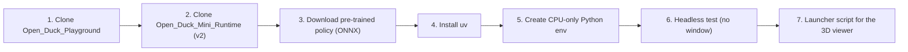
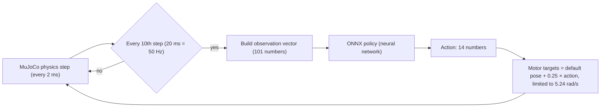

# 01: Setting up Open Duck Playground and running the pre-trained policy

  

**Date:** 2026-11-01

**Machine:** Pop!_OS 24.04 laptop, Intel Iris Xe (no NVIDIA GPU), Python 3.12

**Goal:** the "motivation shortcut" from the [learning roadmap](learning_roadmap.md). See the full pipeline working (simulated robot + trained neural network) *before* studying how it works.

  

---

  

## 1. Overview: what was done

  



  

Resulting folder layout:

  

```

OpenDuck/

├── Documentation/

│ ├── learning_roadmap.md

│ └── 01_playground_setup_and_pretrained_policy.md ← this file

├── policies/

│ └── BEST_WALK_ONNX_2.onnx ← official pre-trained walking policy

├── repos/

│ ├── Open_Duck_Playground/ ← simulation + RL training code (with .venv)

│ ├── Open_Duck_Mini_Runtime/ ← code for the real robot (v2 branch)

│ └── headless_walk_test.py ← my test script

├── run_duck_demo.sh ← launches the 3D viewer demo

└── README.md

```

  

---

  

## 2. Step by step

  

### Step 1: Clone the training / simulation repository

  

```bash

git clone --depth 1 https://github.com/apirrone/Open_Duck_Playground.git \

~/Documents/OpenDuck/repos/Open_Duck_Playground

```

  

- `--depth 1` downloads only the latest version, without the full history (smaller and faster).

- **What's inside** (the important parts):

  

| Path | Purpose |

|---|---|

| `playground/open_duck_mini_v2/xmls/` | The robot model in **MJCF** (MuJoCo's XML format) plus the scenes (flat ground, rough terrain, with or without backlash) |

| `playground/open_duck_mini_v2/joystick.py` | The **RL training environment**: observations, rewards, randomisation |

| `playground/open_duck_mini_v2/runner.py` | Starts **training** (needs a GPU in practice) |

| `playground/open_duck_mini_v2/mujoco_infer.py` | Runs a trained policy in the MuJoCo **viewer** with keyboard control |

| `playground/open_duck_mini_v2/data/polynomial_coefficients.pkl` | **Reference gait** data (from the reference motion generator) |

| `playground/common/export_onnx.py` | Converts a trained checkpoint to ONNX |

  

### Step 2: Clone the robot runtime repository (v2 branch)

  

```bash

git clone --depth 1 -b v2 https://github.com/apirrone/Open_Duck_Mini_Runtime.git \

~/Documents/OpenDuck/repos/Open_Duck_Mini_Runtime

```

  

- Not needed for the simulation, but its README says where the **official pre-trained policy** is. You'll need this repo anyway in Phases 1 and 8 (servo setup and deployment).

- `-b v2` selects the branch for the v2 robot. **Always use v2 branches** for your build.

  

### Step 3: Download the pre-trained policy

  

Neither repo contains a trained policy file. The Runtime README (line ~174) links to it in the main `Open_Duck_Mini` repo:

  

```bash

curl -L --create-dirs -o ~/Documents/OpenDuck/policies/BEST_WALK_ONNX_2.onnx \

https://raw.githubusercontent.com/apirrone/Open_Duck_Mini/v2/BEST_WALK_ONNX_2.onnx

```

  

- **ONNX** (Open Neural Network Exchange) is a standard file format for neural networks. Training happens in JAX, and the result is exported to ONNX so it can run anywhere, including on the robot's Raspberry Pi, using `onnxruntime`.

- The file is only **~860 KB**: the whole walking "brain" is a small neural network.

  

### Step 4: Install `uv` (Python package manager)

  

```bash

curl -LsSf https://astral.sh/uv/install.sh -o /tmp/uv_install.sh

UV_NO_MODIFY_PATH=1 sh /tmp/uv_install.sh

```

  

- The Open Duck repos use [`uv`](https://docs.astral.sh/uv/) to manage Python environments. It's a much faster replacement for `pip` + `venv`.

- Installed to `~/.local/bin/uv`. It was **not** added to your PATH automatically. To be able to type just `uv`:

```bash

echo 'export PATH="$HOME/.local/bin:$PATH"' >> ~/.bashrc && source ~/.bashrc

```

  

### Step 5: Create a CPU-only Python environment

  

```bash

cd ~/Documents/OpenDuck/repos/Open_Duck_Playground

~/.local/bin/uv venv --python 3.12 .venv

~/.local/bin/uv pip install --python .venv/bin/python \

mujoco onnxruntime jax playground etils ml_collections numpy pygame

```

  

**Why not the README's `uv sync`?** The repo's `pyproject.toml` asks for:

- `jax[cuda12]`: several GB of NVIDIA CUDA libraries, useless without an NVIDIA GPU.

- `tensorflow` + `tf2onnx`: only needed to **export** newly trained policies to ONNX.

  

For running a policy on a laptop, only these are needed:

  

| Package | Role |

|---|---|

| `mujoco` | The physics simulator (and its 3D viewer) |

| `onnxruntime` | Runs the ONNX neural network |

| `jax` (CPU) | Imported by the robot base classes (JAX is what makes GPU training fast) |

| `playground` | Google DeepMind's **MuJoCo Playground** (the RL framework the duck's environments are built on). Brings `brax` (PPO implementation), `flax`, `mujoco-mjx` |

| `etils`, `ml_collections` | Small utilities used by the code (paths, configs) |

| `pygame` | Joystick/gamepad support |

  

Total: 80 packages, about 450 MB.

  

> [!IMPORTANT]

> On a **GPU machine** (lab server or cloud) used for training, use the official `uv sync` instead, so you get CUDA JAX and the ONNX export tools.

  

### Step 6: Headless test (no window)

  

Before opening a GUI, I checked that everything works with a script that runs the simulation without any display: [`repos/headless_walk_test.py`](../repos/headless_walk_test.py).

  

```bash

cd ~/Documents/OpenDuck/repos/Open_Duck_Playground

PYTHONPATH=. JAX_PLATFORMS=cpu .venv/bin/python ../headless_walk_test.py

```

  

- `PYTHONPATH=.` lets Python find the repo's `playground` package (the script lives outside the repo folder).

- `JAX_PLATFORMS=cpu` tells JAX not to look for a GPU (avoids warnings).

- The script uses the repo's own `MjInfer` class (from `mujoco_infer.py`) and **reproduces its control loop exactly**, minus the viewer. It commands "walk forward at max speed (0.15 m/s)" for 10 simulated seconds, then reports distance travelled and whether the duck is still standing.

  

**Results:**

  

| Scene | Distance in 10 s | Final state |

|---|---|---|

| `scene_flat_terrain.xml` | **0.90 m** forward, 0.12 m sideways | ✅ standing (base height 0.16 m) |

| `scene_rough_terrain_backlash.xml` | −0.07 m (no progress) | ❌ fell / stuck |

  

The forward speed reached was about 0.09 m/s against a 0.15 m/s command. The tracking isn't perfect: the duck is slower than commanded and drifts a bit sideways.

  

### Step 7: Launcher script for the interactive 3D viewer

  

[`run_duck_demo.sh`](../run_duck_demo.sh) wraps the official command:

  

```bash

PYTHONPATH=. JAX_PLATFORMS=cpu .venv/bin/python playground/open_duck_mini_v2/mujoco_infer.py \

-o ../../policies/BEST_WALK_ONNX_2.onnx \

--model_path playground/open_duck_mini_v2/xmls/scene_flat_terrain.xml

```

  

Usage:

```bash

cd ~/Documents/OpenDuck

./run_duck_demo.sh # flat ground

./run_duck_demo.sh rough # rough terrain + backlash

```

  

| Key | Action |

|---|---|

| ↑ / ↓ | Walk forward / backward |

| ← / → | Side-step left / right |

| A / E | Turn left / right |

| P / M | Increase / decrease stepping frequency |

| H | Toggle head-control mode (arrows then move the head) |

| Double-click a body, then Ctrl + right-drag | Apply a push force |

  

> [!NOTE]

> The viewer must be started **from your own terminal**. The AI assistant's sandbox can't open windows on your desktop (it failed with `GLFW: Wayland: Failed to connect to display`). That's a sandbox limitation, not a problem with your setup.

  

---

  

## 3. What is actually happening: the control loop explained

  

When the demo runs, this loop repeats:

  



  

- **Physics runs at 500 Hz** (`sim_dt = 0.002`), but **the policy runs at 50 Hz** (`decimation = 10`). That's the same rate as on the real robot.

- **The policy outputs joint position targets**, not torques, just like the real Feetech servos accept position commands. In simulation, MuJoCo's `position` actuators play the role of the servos' internal PD controllers.

- **Speed limit:** targets are clipped so no joint is asked to move faster than **5.24 rad/s**, the STS3215 servo's real maximum speed. This is one small sim-to-real detail.

  

### The observation: what the policy "sees" (101 numbers)

  

| Part | Size | Meaning | Available on the real robot from |

|---|---|---|---|

| Gyroscope | 3 | Body angular velocity | IMU (BNO055) |

| Accelerometer | 3 | Body acceleration (includes gravity, so it indicates tilt) | IMU |

| Command | 7 | Desired velocity x, y, turn + 4 head targets | Joystick |

| Joint positions | 14 | Current angle minus the default "home" pose | Servo position feedback |

| Joint velocities | 14 | Scaled by 0.05 | Servo feedback |

| Last 3 actions | 3 × 14 = 42 | Short memory of what it just did | Kept in software |

| Motor targets | 14 | Current commanded positions | Kept in software |

| Foot contacts | 2 | Is each foot touching the ground? | Foot switches |

| Gait phase | 2 | cos/sin of the position in the step cycle (a "clock") | Kept in software |

| **Total** | **101** | | |

  

Things to notice (they come back in Phases 5–6):

- **Every input exists on the real robot.** There is no "true position in the world" or "ground friction", because the robot can't measure those. This is a key design rule for sim-to-real.

- **The gait phase clock** comes from the **reference motion**. During training, the imitation reward compared the duck's joints with the reference gait at this phase. That's why the walk looks natural rather than chaotic.

- The code adds a hard-coded **+1.3 offset to the accelerometer's x value**. Hand-tuned corrections like this usually compensate for a difference between simulation and the real IMU. Worth investigating later.

  

### The action: what the policy outputs (14 numbers)

One value per servo: 5 per leg (hip yaw, hip roll, hip pitch, knee, ankle) and 4 for the neck/head (neck pitch, head pitch, head yaw, head roll). Each value is an **offset from the default standing pose**, scaled by 0.25.

  

---

  

## 4. Observations and first lessons

  

1. **The whole walking skill is a ~860 KB neural network** that maps 101 sensor numbers to 14 joint targets, 50 times per second.

2. **Robustness has limits:** the same policy fails on rough terrain with backlash modelled. Possible reasons to investigate:

- It wasn't trained (or not trained enough) on that terrain.

- The backlash model adds dynamics it never saw.

- The rough terrain's height or offset differs from what the policy expects.

  

This is exactly what **domain randomisation** and **curriculum learning** (Phase 6) are meant to address.

3. **Velocity tracking is imperfect** (about 0.09 vs. 0.15 m/s commanded). Tracking rewards and command ranges are a design choice you'll be able to change when you train your own policy.

  

## 5. Troubleshooting

  

| Problem | Fix |

|---|---|

| `ModuleNotFoundError: No module named 'playground'` | Run from inside `repos/Open_Duck_Playground` with `PYTHONPATH=.` |

| `uv: command not found` | Use `~/.local/bin/uv` or add it to PATH (Step 4) |

| `could not initialize GLFW` | No display available. Run from a normal desktop terminal, not over SSH or a sandbox |

| JAX warnings about CUDA/GPU | Harmless on this laptop; set `JAX_PLATFORMS=cpu` |

| `uv sync` downloading huge CUDA packages | Expected. Only use `uv sync` on the GPU training machine |

  

## 6. Suggested experiments

  

- [ ] Push the duck with Ctrl + right-drag: how hard can you push before it falls? Does it fall forward more easily than sideways?

- [ ] Use **P / M** to change the stepping frequency: when does the walk break down?

- [ ] Run `./run_duck_demo.sh rough` and watch *how* it fails.

- [ ] In `headless_walk_test.py`, change `m.commands` (e.g. sideways `[0, 0.2, 0, ...]` or turning `[0, 0, 1.0, ...]`) and compare commanded vs. achieved motion.

- [ ] Open `xmls/open_duck_mini_v2.xml` and find the 14 actuators and the `home` keyframe (the default pose used above).

  

## 7. Next step

Phase 2 exercise: walk through the robot model file (`open_duck_mini_v2.xml`) and compare it with the Onshape CAD.